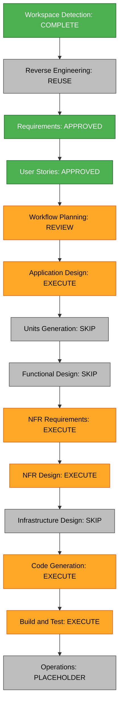

# Bui Duc Anh portfolio execution plan

Status: approved; implementation plan approved and all twelve steps completed; generated-code review pending.

## Approved inputs

- [Requirements](../requirements/bui-duc-anh-requirements.md): FR-01 through FR-08 and PR-01 through PR-06.
- [Stories](../user-stories/bui-duc-anh/stories.md): eight stories approved with "approve and continue".
- [Personas](../user-stories/bui-duc-anh/personas.md): admissions reader, scientifically interested peer and portfolio owner.
- Existing reverse-engineering architecture, component inventory, technology stack and dependencies; current App, entry point, TypeScript configuration and source inventory checked against those documents.

## Scope and impact

Replace the public application in this single React/TypeScript/Vite package. Keep GitHub Pages hosting and its repository-base handling. Build an English materials-science portfolio with a laboratory-notebook visual direction, source-supported content, conceptual scientific illustrations and a reviewed certificate collection.

The old template selector, old-owner portfolio content, journal and NUS talk become obsolete public features. Application Design will define a lean replacement component structure and the safe behavior of legacy hashes. Existing source documents remain local and ignored. No database, authentication, server, external API or live scientific simulator is introduced.

| Area | Change | Priority and relationship |
| --- | --- | --- |
| App, main entry and global styles | Major | Critical: establishes the new identity and component tree. |
| Content and scientific illustrations | Major | Critical: supplies every public section; factual claims depend on supplied sources. |
| Certificate assets and publication allowlist | Major | Critical: review precedes copying any file into a public path. |
| Legacy components, templates, talk, content and old media | Major retirement | Critical: remove obsolete application references and active assets; preserve unrelated user edits and private local inputs. |
| Tests and test setup | Major update | Important: replace obsolete feature assumptions with meaningful new acceptance checks. |
| HTML metadata and public assets | Minor | Critical: eliminate stale public identity and starter resources. |
| Package manifest and lockfile | Conditional cleanup | Important only if retired functionality leaves unused dependencies; no upgrades required by this plan. |
| Vite and GitHub Actions | Retain | Verify the existing static build and base path; no new infrastructure planned. |
| README and deployment guidance | Update as needed | Important: document the replacement and safe content editing. |

Dependencies: React root renders App; App renders sections from public content and approved certificate assets. Vite compiles that tree and copies public assets into dist; GitHub Actions deploys dist. Unimported source files can still be published through Git, so inspection must cover both Git changes and build output.

## Risk and coordination

Overall risk: medium, because the replacement spans many files and document privacy cannot be checked from visible UI alone. Testing complexity: moderate. Rollback is straightforward for tracked application edits; do not rewrite history or remove original private local documents. Restoring a prior site would restore that prior public identity and must be an intentional decision.

One cohesive unit: `materials-portfolio`. Work sequentially within the package; no inter-service or version coordination is needed. No agent delegation is planned. Document review may reveal that a PDF should be withheld; safe summaries preserve the site's value in that case. Browser/PDF tooling availability remains to be checked during implementation; report limits and withhold uncertain files rather than assume approval.

## Workflow visualization

Text alternative: workspace detection, reused reverse engineering, approved requirements and approved stories lead to this workflow review. Next: Application Design; skip Units Generation and Functional Design; perform NFR Requirements, NFR Design, Code Generation, and Build and Test; skip Infrastructure Design. Operations remains a placeholder. Each executed stage retains its specified AI-DLC review gate.

## Stage decisions

| Stage | Decision and depth | Reason |
| --- | --- | --- |
| Workspace Detection | Complete | Existing portfolio and new local inputs identified. |
| Reverse Engineering | Reuse existing artifacts; no rerun | Existing boundaries and current source checks are sufficient to plan this replacement. |
| Requirements Analysis | Approved, standard | Public behavior, source accuracy and privacy policies agreed. |
| User Stories | Approved, concise | Eight stories establish visitor and owner acceptance. |
| Workflow Planning | Execute, this document | Map impact, sequencing and review gates. |
| Application Design | Execute, concise | New custom sections and replacement routing/component boundaries need definition. |
| Units Generation | Skip | One static UI package and one cohesive unit; no service decomposition. |
| Functional Design | Skip | Read-only content presentation and ordinary anchor/document links; no domain schema, complex algorithm or new business logic. |
| NFR Requirements | Execute, concise | Privacy, accessibility and asset/build quality need measurable criteria. Optional Security Baseline remains disabled. |
| NFR Design | Execute, concise | Define public asset allowlisting and verification controls that implement those criteria. |
| Infrastructure Design | Skip | Retain existing GitHub Pages deployment; no new hosting or cloud resources. |
| Code Generation | Execute | Prepare a detailed checkbox plan, obtain approval, then build the replacement. |
| Build and Test | Execute | Verify working UI, production artifacts, certificate paths and private-source exclusion; create all required instruction/summary files. |
| Operations | Placeholder | No new operations system is designed by this workflow. |

Five stages remain after this plan's approval: Application Design, NFR Requirements, NFR Design, Code Generation, and Build and Test. Each uses all artifacts required by its rule file at concise depth. Skipped stages can be included at the user's request.

## Planned implementation sequence

This sequence informs the later detailed code-generation plan; it does not authorize implementation before the required reviews.

1. Review all five PDF documents locally for visible content, text and metadata. Record only safe decisions; establish the public certificate allowlist. Original DOCX and archives remain excluded.
2. Define public content and copy only approved ordinary certificates into a dedicated asset directory. Withhold uncertain/private documents and avoid fabricated missing contact information.
3. Implement the materials-notebook design, responsive sections, conceptual illustrations, semantic navigation and accessible certificate links.
4. Replace public routing/entry metadata and retire old-owner code, routes and active media with a dependency-aware cleanup. Handle legacy hashes safely.
5. Align dependencies, meaningful tests and editing/deployment instructions with the new application.
6. Run production build and relevant tests; inspect Git changes and built assets for private inputs, stale identity, unapproved PDFs and incorrect base paths. Verify responsive/keyboard behavior where tooling supports it and record any limits.

Critical path: source-document decisions before public certificate integration; application entry/content replacement before retiring dependencies; final code before build/output/privacy verification. Application code stays at the workspace root; AI-DLC documents stay under aidlc-docs.

## Completion and verification criteria

- Root and legacy entry points show Bui Duc Anh's site; none show the former owner's portfolio or talk.
- All eight stories and all fourteen FR/PR requirements have evidence from appropriate checks.
- The visual direction reads as materials science and engineering without overstating student research or study completion.
- Every public PDF matches the reviewed allowlist; document links work under the GitHub Pages base path.
- Private originals and sensitive data are absent from proposed tracked changes and deployment output. Ignore rules alone are not accepted as proof.
- Build and relevant tests pass; responsive, keyboard and reduced-motion checks are completed or their precise limits are reported.
- Build instructions, unit-test instructions, integration-test instructions, performance-test instructions and build-and-test summary are generated. Performance instructions can document appropriate static-site checks without inventing load-test needs.
- No live deployment is claimed until a real deployment result is verified. Preserve GitHub Pages as the hosting target.

Duration is not estimated before document review and tooling checks; the scope is one unit, with the five remaining stages and their prescribed review gates.

## Plan progress

- [x] Load approved inputs, common validation rules and current workspace context.
- [x] Analyze transformation scope, dependencies, risks and single-package sequence.
- [x] Select stages and depth with reasons for every skip.
- [x] Validate the restricted Mermaid grammar and references before creating this file; include a text alternative.
- [x] Prepare the execution plan and update state/audit in this interaction.
- [x] Obtain explicit workflow-plan approval.
- [x] Complete and approve Application Design.
- [x] Complete and approve NFR Requirements.
- [x] Complete and approve NFR Design.
- [x] Approve detailed Code Generation plan, implement, and approve generated code.
- [x] Complete Build and Test and required handoff; Operations approval pending.

## Extension compliance

| Extension or constraint | Status | Rationale |
| --- | --- | --- |
| Security Baseline, SECURITY-01 through SECURITY-15 | N/A | Explicit Q3 B disables the extension; no full-rule enforcement is applied. |
| Property-Based Testing | N/A | Explicit Q4 C disables the extension; full rules remain unloaded. |
| User privacy PR-01 through PR-06 | Applicable; covered in plan | Document allowlisting, local-reference exclusion, Git/build inspection and stale-asset removal are planned. Actual PDF and implementation checks are pending. |

No enabled extension has a blocking finding for this planning artifact. No private source contents are included. Markdown tables, links, checklist and diagram syntax checked before writing; renderer-level Mermaid validation was not run.
